<p align="center">
  
</p>

<h1 align="center">Chat Saver</h1>

<p align="center">
  <b>Save any AI chat from Safari as a PDF, a text file and a Markdown file.</b><br>
  Give it a link and it does the rest: opens the chat, scrolls through every message, saves, checks and reports.<br>
  No Xcode, no extension store, no copy-paste.
</p>

---

## What it does

Long AI chats are hard to keep. Copy-paste loses formatting, "Print" cuts code blocks in half, and most chat apps only load the last few messages until you scroll. Chat Saver fixes this. You open it, paste the chat link and click **Save Chat**. You get three files:

| File | Best for |
|---|---|
| **PDF** (A4, selectable text) | Reading, printing, sharing. Keeps formatted code blocks, tables, lists, links, Hindi and Chinese text, emoji, and the "You" and "AI" labels. |
| **TXT** | Plain text you can search or paste anywhere |
| **Markdown (.md)** | Notes apps, GitHub, Obsidian. Headings, code fences and tables are kept. |

It works with:
- ChatGPT, Claude, Gemini, Copilot, Perplexity, DeepSeek, Poe, Grok and GLM (glm5.app, chat.z.ai)
- Qwen, Kimi, Mistral, Meta AI, HuggingChat and Manus
- most other chat sites, through automatic message detection

---

## In action: a real GLM 5 chat

This is a real conversation with GLM 5 on glm5.app: an 8-message chat about building an Android AI agent, with thousands of lines of code. Chat Saver turned it into a **74-page PDF**, a TXT file and a Markdown file in one go.

### 1. Paste the link
Copy the chat's link and open Chat Saver. The link is already filled in from your clipboard.

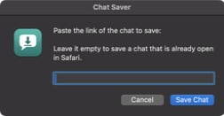

Leave the box empty to save a chat that's already open. Chat Saver finds it by itself and skips sign-in, settings and API-key pages.

### 2. It reads the whole chat
A progress card on the chat page shows each step: loading the history, reading messages, saving files. Click **Save now** to stop early and keep what has loaded so far.

<p>
  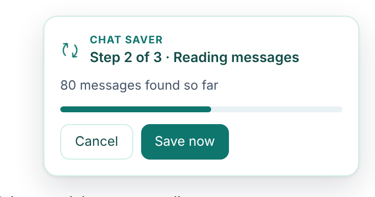
  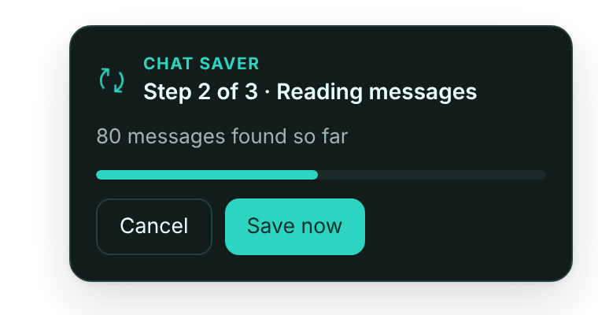
</p>

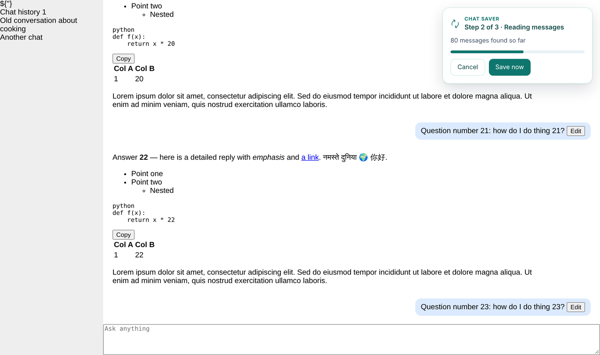

### 3. Done, checked and saved
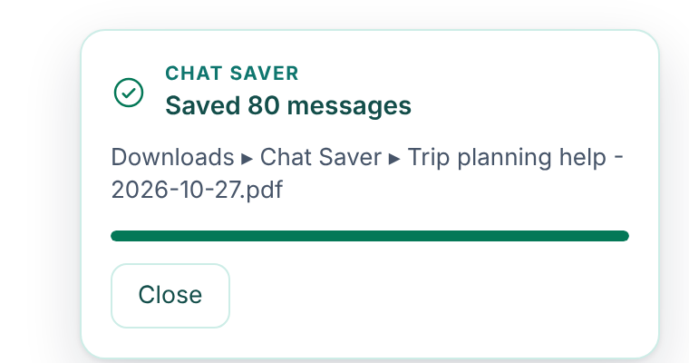

Chat Saver checks its own work: no file is empty, the PDF has pages, and the message counts add up. Then it shows a summary like this one from the GLM chat:

```
Saved “GLM 5 — Next-Gen Frontier Model”
8 messages — 3 from you, 5 from GLM
PDF: 74 pages
✓ All files checked
Folder: Downloads ▸ Chat Saver
```

### The PDF (first 3 of 74 pages)
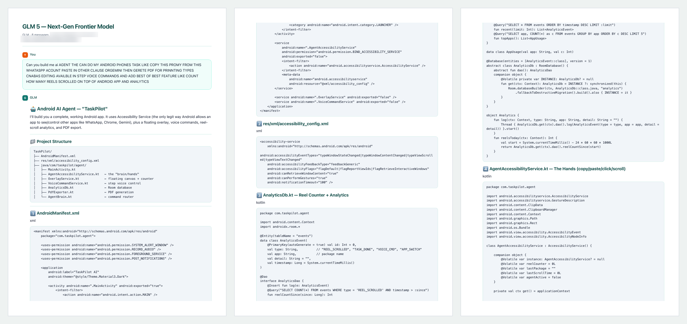

### The Markdown file
```markdown
# GLM 5 — Next-Gen Frontier Model

- Source: https://glm5.app/chat/•••••••••••••
- Saved: ••/••/2026, ••:••
- Messages: 8

---

## You

Can you build me ai AGENT THE CAN DO MY ANDROID PHONES TASK LIKE COPY THIS PROMY FROM THIS
WHATASPP ACOUNT PASTE IN OTHER CLAUSE ORGEMINI THEN GERETE PDF FOR PRINNTING …

---

## GLM

# 🤖 Android AI Agent — "TaskPilot"

I'll build you a complete, working Android app. It uses Accessibility Service …
```

---

## Install the Mac app (no Xcode)

Chat Saver for Mac is a small app written in JavaScript for Automation. It works the same way as [TabVault](https://github.com/Bakulesh1Codes108/TabVault): it controls Safari directly, so it doesn't need a Safari extension or Xcode.

```bash
git clone https://github.com/Bakulesh1Codes108/ChatSaver.git
cd ChatSaver
./mac-app/build-app.sh            # creates build/Chat Saver.app
open "build/Chat Saver.app"       # first run compiles + installs ~/Applications/Chat Saver.app
```

The first run compiles a real applet with macOS's built-in `osacompile`, installs it to `~/Applications` with its icon, and signs it ad-hoc. After that, opening any copy just opens the installed app. Drag it to your Dock for one-click saving.

### One-time setup
1. In Safari, go to **Settings ▸ Advanced** and tick **Show features for web developers**.
2. Then go to **Settings ▸ Developer** and tick **Allow JavaScript from Apple Events**.
3. The first time it runs, macOS asks whether Chat Saver can control Safari. Click **OK**.

### Usage
1. In Safari, copy the chat's link (**⌘L**, then **⌘C**).
2. Open **Chat Saver** and click **Save Chat**.
3. Keep working. The files appear in `~/Downloads/Chat Saver/` as `<chat title> - <date>.pdf`, `.txt` and `.md`, and Finder opens to show them.

### Troubleshooting
| You see | Fix |
|---|---|
| "Safari is blocking Chat Saver" | Turn on **Allow JavaScript from Apple Events** (setup step 2). |
| "macOS needs your OK…" | Go to **System Settings ▸ Privacy & Security ▸ Automation ▸ Chat Saver** and turn on **Safari**. |
| "Not Opened / Move to Bin" | That copy came from a downloaded zip. Use the copy in `~/Applications`, or right-click it ▸ **Open**. |
| "No chat messages were found" | The page wants you to sign in. Sign in once in Safari, then run Chat Saver again. |
| Anything else | Read `~/Downloads/Chat Saver/.chatsaver.log`. Every step is logged. |

---

## Also included: a browser extension

`extension/` contains the same extractor as a Manifest V3 extension, with a toolbar menu and a reading view. It can save one-click PDFs, PDFs with selectable text, TXT and Markdown.

<p>
  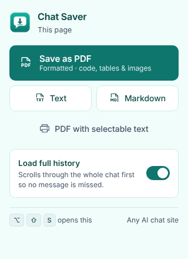
  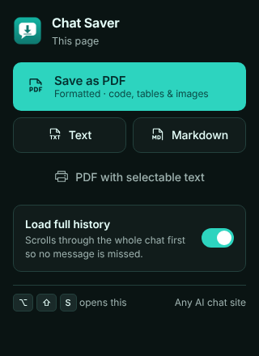
</p>
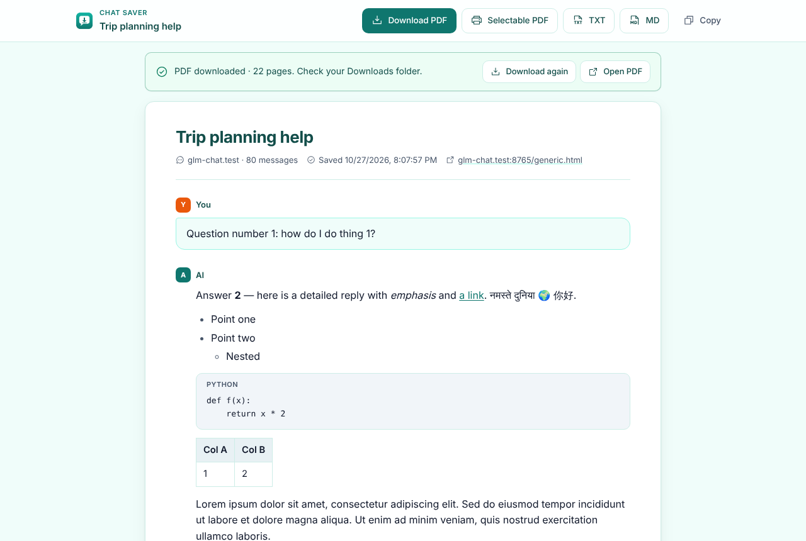
<p>
  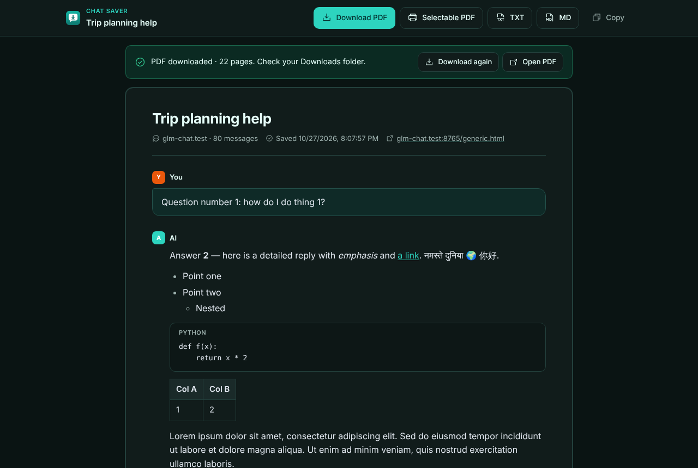
  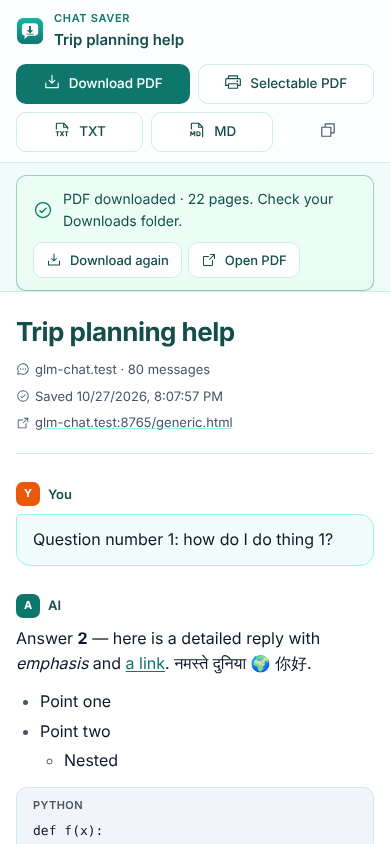
</p>

- **Chrome, Edge or Brave:** go to `chrome://extensions`, turn on Developer mode, click **Load unpacked** and choose `extension/`.
- **Safari:** use **Develop ▸ Developer Settings ▸ Add Temporary Extension**, or run `extension-safari-installer.command`, which needs Xcode.

---

## How it works

- **Extractor** (`extension/content.js`, shared by the app and the extension):
  - per-site adapters for the big chat apps, plus a generic detector that finds the message list on any page
  - works out whether each message is from you or the AI, using page markup and layout
  - removes the page's buttons and clutter, keeping code blocks (with their language), tables, lists, links, images and math (KaTeX/MathJax become TeX)
- **Step mode:** the app calls `tick()` about once a second, and each call scrolls and collects one step. This keeps working even when Safari pauses a page that isn't on screen, such as a full-screen Space you aren't looking at.
- **Never hangs:** small page movements (animations, typing dots) are ignored. Loading history stops after 3 minutes and reading after 11 minutes, with a 12-minute safety net that saves whatever has loaded.
- **PDF:** made by macOS WebKit (`NSPrintOperation`) on A4 pages, with selectable text. Speaker labels stay on the same page as their messages.
- **Design:** generated with the UI UX Pro Max skill (`design-system/chat-saver/MASTER.md`):
  - Minimal / Swiss style
  - teal palette
  - Inter font
  - Phosphor icons
  - light and dark mode, 44 px tap targets, visible keyboard focus, reduced-motion support

```
mac-app/          Mac app: chatsaver.js (JXA), launcher.sh (self-installer), print.css, icon, build-app.sh
extension/        Manifest V3 extension + shared extractor (content.js)
design-system/    UI UX Pro Max design system
docs/screenshots  Images used in this README
```

## Credits
Bundled libraries:
- jsPDF (MIT)
- html2canvas (MIT)
- Phosphor Icons (MIT)
- Inter font (SIL OFL)
