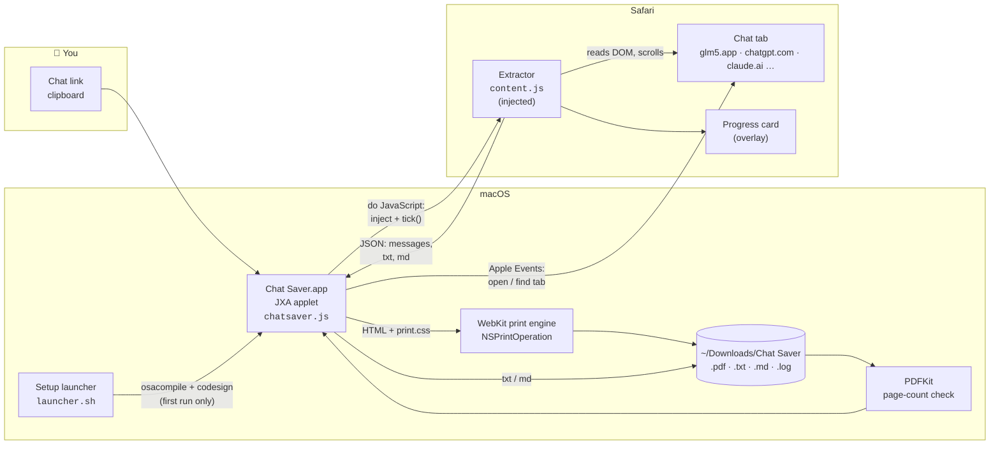
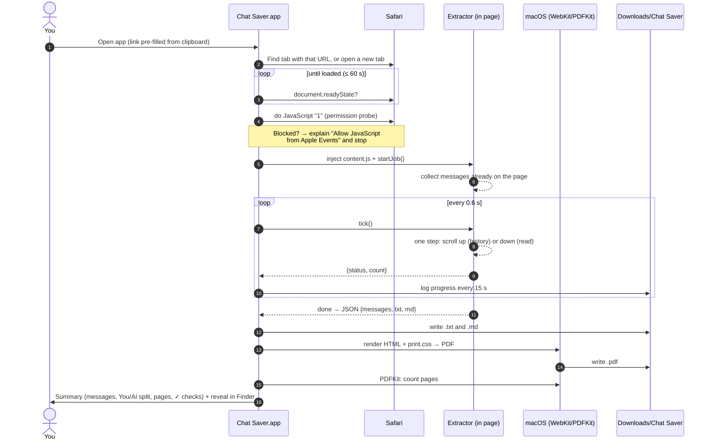
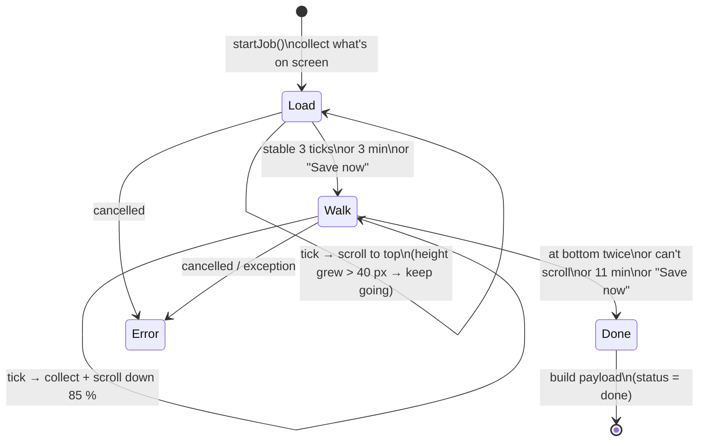
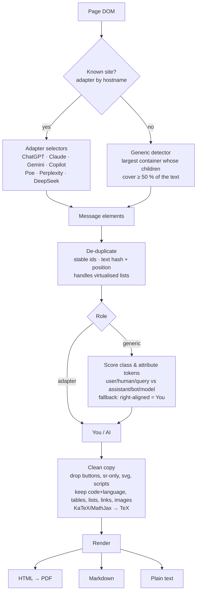
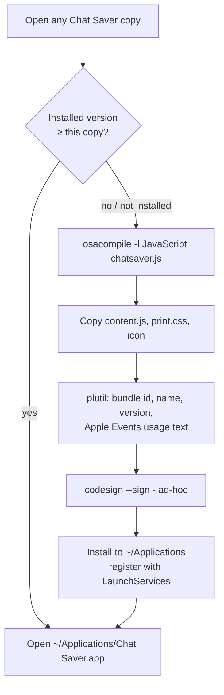

# Chat Saver: Architecture

Chat Saver has three parts:

1. **The extractor** (`extension/content.js`) runs inside the chat page. It finds the messages, scrolls through the conversation and turns each message into clean HTML, Markdown and plain text.
2. **The Mac app** (`mac-app/chatsaver.js`) is a JavaScript for Automation (JXA) applet. It drives Safari through Apple Events, injects the extractor, collects the result and writes the PDF, TXT and MD files with macOS's own frameworks.
3. **The browser extension** (`extension/`) uses the same extractor with a toolbar menu and an export page. It's an alternative to the Mac app for Chrome-family browsers, or Safari with Xcode.

The design system (`design-system/chat-saver/MASTER.md`, generated with UI UX Pro Max) gives all of them the same colours, type and components.

---

## 1. Components



| Part | File | Job |
|---|---|---|
| Setup launcher | `mac-app/launcher.sh` | On first run, compiles `chatsaver.js` into a real applet with `osacompile`, adds the icon, signs it ad-hoc and installs it to `~/Applications`. Later runs open the installed app, unless the launcher is a newer version. |
| App | `mac-app/chatsaver.js` | Handles the link prompt and tab finding, checks Safari permissions, injects the extractor, drives the scrolling, writes the files, checks them and shows the summary. |
| Extractor | `extension/content.js` | Detects messages and roles, scrolls through the chat, cleans each message, renders Markdown and text, and shows the progress card. |
| PDF style | `mac-app/print.css` | A4 print layout with the design-system tokens. Speaker labels stay on the same page as their messages. |
| Extension | `extension/*` | Manifest V3 toolbar menu and export page, with a one-click PDF (jsPDF + html2canvas). |

---

## 2. One save, step by step



---

## 3. Why step mode ("tick")?

Safari pauses timers in pages that aren't on screen, for example a chat open in a full-screen Space you aren't looking at. An extractor that scrolls with its own timers (`setTimeout` loops) freezes there. The first versions did, and showed "8 messages after 400 s".

So the **app** drives the extractor: each `tick()` call does one synchronous step. Calls made through Apple Events run even while the page's own timers are paused, so the job always moves forward.



**Safety rules built in:**
- **Only real growth counts.** Some chat sites move a few pixels forever (typing dots, animations). The history step ignores height changes under 40 px; this was the cause of an early 20-minute hang on glm5.app.
- **Time limits:** loading history stops after 3 minutes and reading after 11 minutes. After 12 minutes the app calls `finishNow()` and saves whatever has loaded.
- **Save now** on the progress card stops early and keeps everything collected so far.

---

## 4. Inside the extractor



The scroller is found automatically, whether it's the window or an inner panel. It also handles `column-reverse` lists, where the newest message is at scroll position 0.

---

## 5. Install and update flow (no Xcode)



**Lessons this design encodes:**
- **Downloaded zips are quarantined by macOS,** so an unsigned app unzipped from one shows "Not Opened / Move to Bin". The README tells people to build from source or use the installed copy. Extra copies just open the installed app and never rebuild or downgrade it.
- **The setup log goes to `~/Library/Logs`,** which never needs permission, so a blocked Downloads folder can't break setup.
- **The applet is compiled on the Mac itself,** so it gets a real bundle and icon in the Dock and in its dialogs, like TabVault. A plain shell-script wrapper would show up as "osascript".

---

## 6. Permissions

| Permission | Why | Who grants it |
|---|---|---|
| Safari ▸ Developer ▸ **Allow JavaScript from Apple Events** | Lets the app run the extractor in the page | You, once |
| **Automation:** Chat Saver → Safari | Lets the app read tabs and open the link | You, once (macOS asks) |
| **Files:** Downloads | Saving the files | macOS asks the first time |

Nothing is sent anywhere. The chat goes from Safari to the app to files on your Mac.

---

## 7. Folder map

```
ChatSaver/
├── mac-app/
│   ├── chatsaver.js        # JXA app: link prompt, tab finding, tick loop, files, PDF, checks
│   ├── launcher.sh         # self-installer (osacompile → sign → ~/Applications)
│   ├── print.css           # PDF layout (design-system tokens)
│   ├── AppIcon.icns        # icon (macOS grid)
│   └── build-app.sh        # assembles "Chat Saver.app" from these files
├── extension/
│   ├── content.js          # shared extractor (adapters, detector, cleaner, tick())
│   ├── manifest.json       # Manifest V3
│   ├── popup.*             # toolbar menu
│   ├── export.*            # reading view + one-click PDF
│   ├── theme.css, icons.js # design tokens, Phosphor icons
│   └── lib/                # jsPDF, html2canvas (bundled)
├── design-system/chat-saver/MASTER.md
└── docs/
    ├── ARCHITECTURE.md     # this file
    └── screenshots/
```
